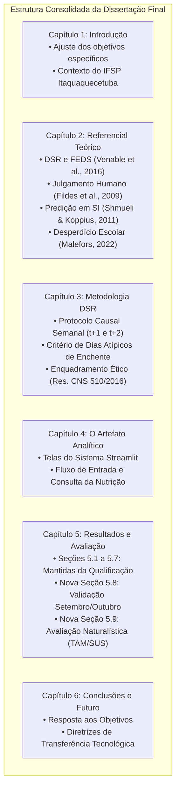

# 🏛️ PLANO MESTRE DE ADEQUAÇÃO DA DISSERTAÇÃO PARA A DEFESA (DEZEMBRO/2026)
## Transição Oficial da Qualificação para a Versão Final da Dissertação de Mestrado Profissional

* **Autor:** Michel Silva de Souza
* **Programa:** Mestrado Profissional em Informação e Tecnologia (IFSP / CEETEPS)
* **Orientação:** Prof. Dr. Arima / Coorientação
* **Meta Temporal:** Submissão da versão final em meados de Novembro para **Defesa Pública em Dezembro de 2026**.
* **Status do Documento:** Plano de Trabalho Consolidado (Baseado nas Transcrições da Arguição, Orientações de Pares e Artigos Recomendados).

---

## 1. Diretrizes Estratégicas e Princípios de Blindagem

1. **Preservação Integral da Qualificação:** Os resultados consolidados apresentados e aprovados pela banca até 31/08/2026 (Figuras 1 a 28 e tabelas do Capítulo 5) permanecem como o marco histórico de desenvolvimento e calibração do artefato.
2. **Evolução Focada para a Defesa:** Em vez de reescrever capítulos anteriores, a dissertação receberá:
   * **No Capítulo 2:** Aprofundamento teórico com os artigos recomendados pela banca;
   * **No Capítulo 3:** Formalização do protocolo causal prospectivo e do desenho de avaliação DSR;
   * **No Capítulo 4:** Apresentação da interface gráfica (Streamlit) como demonstrador do artefato analítico;
   * **No Capítulo 5:** Duas novas subseções de alto impacto:
     * **Seção 5.8:** *Validação Prospectiva em Tempo Real: Avaliação Causal dos Meses de Setembro e Outubro de 2026* (Figuras 29 a 33 e Tabelas 29 a 31);
     * **Seção 5.9:** *Avaliação Naturalística Ex-Post: Factibilidade, Utilidade e Usabilidade na Ótica da Nutricionista e da Gestora*.
3. **Prazo Viável para Dezembro:** A janela empírica encerra-se formalmente em **30 de Outubro de 2026** (totalizando 32 dias de validação cega), liberando o mês de novembro exclusivamente para a redação e agendamento da banca.

---

## 2. Mapa de Alterações Capítulo a Capítulo

### Capítulo 1: Introdução
* **Ajuste de Redação nos Objetivos Específicos:** Substituir formulações excessivamente procedimentais (ex: "rodar o algoritmo X") por metas analítico-conceituais (ex: *"Avaliar a resiliência de modelos preditivos sob perturbações exógenas e eventos climáticos extremos"* e *"Quantificar o trade-off entre risco social de desabastecimento e custos financeiros de desperdício alimentar"*).
* **Fundamentação do Escopo Institucional:** Explicitar a relevância da alimentação escolar no IFSP como política pública de permanência estudantil contra a evasão.

### Capítulo 2: Fundamentação Teórica (Inclusão dos Artigos da Banca)
* **Avaliação em Design Science Research:** Inserir subseção ancorada em **Venable, Pries-Heje & Baskerville (2016)** (*FEDS – Framework for Evaluation in DSR*) e **Thuan et al. (2019)**, justificando a transição da avaliação artificial/laboratorial para a avaliação naturalística com usuárias reais.
* **Previsão em Sistemas de Informação:** Incorporar **Shmueli & Koppius (2011)** (*Predictive Analytics in IS* – MISQ), distinguindo modelagem estatística explicativa ($R^2$ retrospectivo) de poder preditivo prático out-of-time.
* **Intervenção de Julgamento Humano em Séries Temporais:** Inserir a teoria de **Fildes, Goodwin, Lawrence & Nikolopoulos (2006, 2009)** (*Effective forecasting and judgmental adjustments*), demonstrando que especialistas humanos tendem a introduzir viés de excesso de confiança ou cautela desmedida, o que legitima formalmente a criação do **Modelo Híbrido** e das margens de segurança conformal.
* **Desperdício em Restaurantes Escolares:** Citar **Malefors et al. (2022)** (*Testing interventions to reduce food waste in school catering*) para apoiar as métricas de sobras limpas.

### Capítulo 3: Percurso Metodológico DSR
* **Garantia de Causalidade (No-Leakage):** Documentar o protocolo de corte temporal semanal (sexta-feira $T$, utilizando estritamente dados conhecidos até $T$ para projetar $T+1$ e $T+2$).
* **Governança de Dias Atípicos:** Formalizar os critérios técnicos da Camada Bronze para identificação de eventos extremos de inundação e colapso de mobilidade urbana na Bacia do Alto Tietê.
* **Enquadramento de Ética em Pesquisa:** Registrar formalmente a dispensa de registro no sistema CEP/CONEP com base na **Resolução CNS nº 510/2016 (Art. 1º, Parágrafo Único, Incisos I e V)**, por se tratar de teste de usabilidade tecnológica de processos de gestão com servidores públicos no exercício de suas funções habituais.

### Capítulo 4: Desenvolvimento e Demonstração do Artefato
* **Justificativa do Termo "Analítico":** Explicar que o artefato não é apenas um script, mas um ambiente computacional integrado que calcula variáveis exógenas (clima), agrega histórico e prescreve faixas de decisão.
* **Interface Gráfica Streamlit:** Inserir 2 a 3 figuras da aplicação visual ([src/app](file:///f:/PROJETOS/ARTEFATO/src/app)), demonstrando:
  * Tela de cadastro semanal de cardápio e consulta meteorológica;
  * Painel de previsões para os horizontes $t+1$ (preparo) e $t+2$ (compras);
  * Chave de alerta meteorológico (modo contenção).

### Capítulo 5: Resultados e Discussão
* **Seções 5.1 a 5.7:** Preservadas integralmente da Qualificação (coorte de 73 datas até agosto de 2026, Figuras 1 a 28).
* **Nova Seção 5.8: Validação Prospectiva em Tempo Real (Setembro e Outubro de 2026):**
  * *Parte 1 (Setembro):* Choque de enchentes, quedas anômalas para 14 e 23 refeições, recálculo de margens Conformal P75/P85 e superioridade do Híbrido com Margem Prudencial (+12 ref) sobre o humano (MAE 8.41 vs 11.00) — **Figuras 29, 30, 31 e 33 / Tabelas 29 e 30**.
  * *Parte 2 (Outubro):* Teste cego da semana de retorno pós-recesso (19 a 23/10), onde a IA cravou 182,3 ref/dia contra 183,6 reais na catraca, evitando o desabastecimento de mais de 250 refeições que a intuição humana causaria — **Figura 32 / Tabela 31**.
* **Nova Seção 5.9: Avaliação Naturalística de Usabilidade, Utilidade e Factibilidade:**
  * Apresentação da pesquisa com a Nutricionista Responsável Técnica e a Gestora do Restaurante.
  * Tabulação das pontuações médias da escala Likert (TAM / SUS) e análise qualitativa das respostas da entrevista estruturada.

### Capítulo 6: Conclusões e Trabalhos Futuros
* Síntese das respostas às questões de pesquisa (Thuan et al., 2019).
* Recomendações organizacionais de transferência tecnológica para continuidade do uso pelo campus em 2027.

---

## 3. Protocolo de Avaliação com Usuárias (Nutricionista e Gestora)

Em concordância com as orientações de pares registradas no arquivo [`Avaliacao_nutricionista_gestora.txt`](file:///f:/PROJETOS/ARTEFATO/defesa/Avaliacao_nutricionista_gestora.txt), o processo não deve ser improvisado, mas sim fundamentado em instrumentos científicos consagrados.

### 3.1. O Instrumento de Coleta (Já Elaborado e Disponível)
O documento completo já está redigido em [`defesa/instrumento_avaliacao_usuarias_dsr.md`](file:///f:/PROJETOS/ARTEFATO/defesa/instrumento_avaliacao_usuarias_dsr.md), contendo:
1. **Termo de Consentimento e Anuência Institucional (TCLE)** em conformidade com a Resolução CNS 510/2016;
2. **Questionário Fechado (11 itens Likert de 1 a 5):**
   * *Bloco A (Usabilidade):* Clareza, simplicidade de localização e facilidade de preenchimento (adaptado da SUS de Brooke e TAM de Davis);
   * *Bloco B (Utilidade):* Apoio à decisão de preparo e compra, percepção da margem prudencial (+12 ref) e antecipação de chuvas (Fildes et al., 2009);
   * *Bloco C (Factibilidade):* Compatibilidade com a carga horária, sustentabilidade sem o pesquisador e integração aos prazos do IFSP (Venable et al., 2016).
3. **Entrevista Semiestruturada (4 Perguntas Diretas):**
   * Pergunta 1: Rotina e influência real da estimativa nas quantidades preparadas;
   * Pergunta 2: Sensação de segurança gerada pela margem prudencial (+12 refeições);
   * Pergunta 3: Comparação entre o comportamento da IA e o feeling humano nos momentos críticos (enchentes e retorno de aulas);
   * Pergunta 4: Pontos fortes e melhorias desejadas para o próximo ano.

### 3.2. Procedimento de Aplicação (Rápido e sem Atrito)
* **Tempo Estimado:** Apenas **15 a 20 minutos** com cada participante.
* **Formato:** Pode ser aplicado presencialmente no campus (com preenchimento do formulário impresso) ou enviado via Google Forms com entrevista gravada via Teams/Meet.
* **Análise dos Dados:** 
  * As notas fechadas geram a média quantitativa de aceitação (Tabela 32 da dissertação);
  * As falas das entrevistas são transcritas e organizadas por núcleos de sentido (utilidade, usabilidade e factibilidade), inserindo trechos literais em itálico no texto para respaldar os achados científicos.

---

## 4. Cronograma de Ações Críticas para a Defesa em Dezembro

| Período | Ação Operacional | Responsável / Entregável |
| :--- | :--- | :--- |
| **Até 31/10/2026** | Fechamento da semana de outubro (imputar consumos de 26 a 30/10 na catraca). | Michel + Antigravity (Re-executar script `gerar_artefatos_defesa_set_out.py`). |
| **01 a 07/11/2026** | Aplicação do questionário e breve entrevista com a Nutricionista (Nutricionista RT) e a Gestora. | Michel (Aplicar instrumento `defesa/instrumento_avaliacao_usuarias_dsr.md`). |
| **08 a 15/11/2026** | Redação final das Seções 5.8 e 5.9 e inserção dos novos referenciais teóricos nos Capítulos 2 e 3. | Redação no arquivo oficial da Dissertação (DOCX/Markdown). |
| **16 a 20/11/2026** | Revisão cruzada de figuras, tabelas, sumário, citações ABNT e envio da versão final aos orientadores. | Revisão geral e validação prévia com o Prof. Arima. |
| **Final de Novembro** | Depósito formal da dissertação para a banca examinadora (mínimo de 15 dias de antecedência). | Protocolo acadêmico oficial no IFSP. |
| **Meados de Dezembro** | **Sessão Pública de Defesa da Dissertação de Mestrado.** | Apresentação com slides sincronizados e aprovação do título de Mestre. |

---

## 5. Próxima Etapa Imediata
Com o plano mestre traçado e o instrumento de avaliação pronto, podemos deixar o texto das **Seções 5.8 e 5.9** estruturado em formato Markdown pronto para ser inserido no arquivo oficial da sua dissertação!
