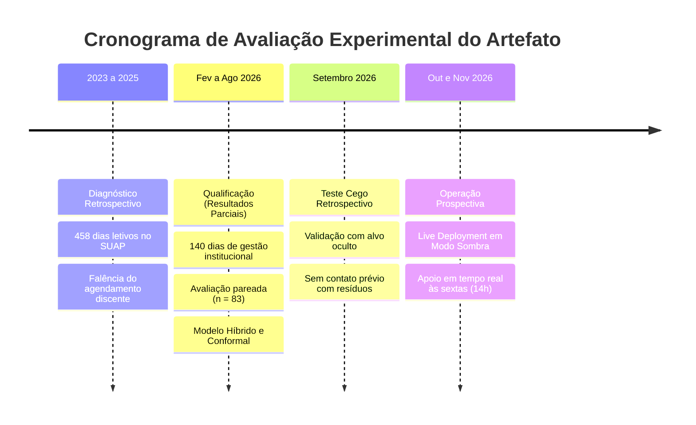
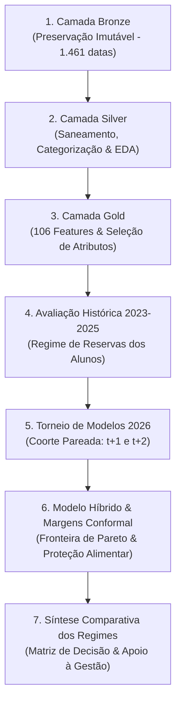

# PLANO DIRETOR DE REVISÃO E MELHORIAS DA DISSERTAÇÃO DE MESTRADO
**Documento Metodológico, Estrutural e Adversarial para o Exame de Qualificação**  
**Pesquisa:** Artefato Analítico-Preditivo para Apoio ao Planejamento da Produção de Refeições em Restaurante Institucional  
**Autor:** Michel Silva de Souza  
**Programa:** Mestrado Profissional em Gestão e Tecnologia em Sistemas Produtivos (CEETEPS / IFSP)  
**Data da Revisão Consolidada:** 14 de Outubro de 2026  

---

> [!IMPORTANT]
> **DIRETRIZ DE SEGURANÇA E INTEGRIDADE DO AMBIENTE COMPUTACIONAL:**  
> Os arquivos originais da dissertação na pasta `dissertacao/` (`.docx` e `.pdf`) e a totalidade dos cadernos analíticos originais em `notebooks/` (`01` a `09`) foram preservados rigorosamente congelados e inalterados. Toda a orquestração gráfica para a produção das ilustrações da dissertação foi concentrada no novo caderno unificado [`notebooks/10_geracao_figuras_dissertacao.ipynb`](file:///f:/PROJETOS/ARTEFATO/notebooks/10_geracao_figuras_dissertacao.ipynb). O presente plano diretor funciona como guia metodológico e manual de intervenção editorial para guiar a revisão do arquivo-fonte no Microsoft Word.

---

## 1. PARECER EDITORIAL: ESCOLHA DO FORMATO DE TRABALHO (.DOCX VS .PDF)

A análise operacional dos fluxos de trabalho acadêmicos evidencia que a edição direta sobre arquivos em formato PDF apresenta severas restrições técnicas, uma vez que documentos compilados não possuem flexibilidade para repaginação dinâmica, quebra harmoniosa de texto ou ancoragem correta de legendas. Em contrapartida, o formato Microsoft Word (`.docx`) viabiliza o controle tipográfico integral, a reformatação de quadros tabulares, o dimensionamento milimétrico de imagens e a automação das listas pré-textuais por meio da atualização nativa de campos de referência (`F9`). 

Dessa forma, estabelece-se como protocolo editorial mandatório que todas as modificações estruturais, ajustes de tabelas, inserção de parágrafos conectivos e substituição de figuras sejam executadas diretamente no arquivo-fonte [`dissertacao/Dissertacao_Michel_qualificacao_resultados_parciais_20261013_entrega.docx`](file:///f:/PROJETOS/ARTEFATO/dissertacao/Dissertacao_Michel_qualificacao_resultados_parciais_20261013_entrega.docx). Concluída a etapa de revisão no processador de texto e validadas as quebras de página, deve-se compilar e exportar a versão definitiva em formato PDF com fontes embutidas e alta resolução, garantindo a padronização visual inviolável para os membros da banca examinadora.

| Eixo de Avaliação | Microsoft Word (`.docx`) | Adobe Acrobat (`.pdf`) | Decisão Editorial Padronizada |
| :--- | :--- | :--- | :--- |
| **Finalidade no Fluxo** | Documento ativo de revisão e redação | Documento final estático para distribuição | Adota-se o `.docx` para edição e gera-se novo `.pdf` ao final. |
| **Flexibilidade de Ajustes** | Ampla liberdade de estilos e tabulação | Inflexível; causa truncamento de layout | O `.docx` é o único meio viável para inclusões e expansões. |
| **Sumário e Listas** | Campos dinâmicos atualizáveis via tecla `F9` | Estático; requer edição manual elemento a elemento | A compilação automática no Word previne erros de paginação. |
| **Submissão à Banca** | Vulnerável a variações entre versões do Word | Padronizado, imutável e multiplataforma | A banca examinadora deve receber exclusivamente o `.pdf` final. |

---

## 2. DELIMITAÇÃO TEMPORAL E METODOLÓGICA: QUALIFICAÇÃO PARCIAL VS. DEFESA FINAL

Para evitar objeções da banca quanto à abrangência do horizonte de teste, a introdução e a conclusão da dissertação devem delimitar com precisão a natureza dos dados analisados no exame de qualificação, diferenciando os resultados históricos retroativos, as evidências operacionais parciais e o cronograma experimental estabelecido para a defesa definitiva.

### 2.1 Resultados Parciais Submetidos ao Exame de Qualificação
Os achados quantitativos reportados no documento de qualificação dividem-se em dois blocos metodológicos complementares:
1. **Bloco Histórico (2023 a 2025 — Regime de Reservas Discentes via SUAP):** Contempla 458 dias letivos operados sob agendamento voluntário pelos estudantes. Esta coorte histórica serve para diagnosticar o descompasso crônico do modelo legado, comprovando matematicamente a subnotificação sistemática em 63,8% dos dias úteis e um déficit potencial acumulado de 9.494 refeições desassistidas pela infraestrutura de atendimento.
2. **Bloco Operacional Parcial (Fevereiro a Agosto de 2026 — Gestão Institucional vs. Modelos Analíticos):** Abrange 28 semanas letivas ininterruptas operando sem agendamento discente. Este bloco avalia a transição para o quantitativo estipulado pela nutricionista escolar (140 registros) e submete a coorte pareada de 83 datas à avaliação temporal sequencial (*Walk-Forward Temporal Validation*). Evidencia-se que os modelos lineares regularizados superaram o planejamento empírico humano no horizonte $t+1$ (Lasso MAE 22,27 e Ridge MAE 22,46 contra 24,92 da nutricionista), enquanto a formulação do Modelo Híbrido 50/50 estabeleceu o menor erro absoluto do estudo (MAE 21,43), calibrado com margens de segurança conformal (+10 e +19 refeições).

### 2.2 Roteiro Metodológico Obrigatório para a Defesa Definitiva
A continuidade da pesquisa, programada para o período posterior à qualificação, incorpora duas etapas adicionais de validação empírica já estruturadas no artefato:
1. **Validação Retrospectiva com Alvo Oculto (*Blind Test* — Dados de Setembro de 2026):** Consiste na aplicação dos hiperparâmetros congelados dos modelos sobre as datas letivas de setembro de 2026, cujos registros de consumo foram preservados isolados durante o treinamento. Esta etapa atesta a estabilidade estatística dos algoritmos frente a uma partição estritamente cega.
2. **Validação Prospectiva em Tempo Real (*Live Deployment* em Modo Sombra — Outubro e Novembro de 2026):** O artefato executará o pipeline automatizado semanalmente às sextas-feiras, pontualmente às 14h00, emitindo as recomendações de produção para $t+1$ e de aquisições para $t+2$ com gravação de carimbo temporal imutável (*timestamp*). Essa rotina monitorará a tomada de decisão da nutricionista gestora em ambiente operacional real, mensurando o nível de conformidade, a redução de sobras de balcão e a proteção contra o desabastecimento.

---

## 3. BLINDAGEM ADVERSARIAL DA PESQUISA (PERSPECTIVA DA BANCA EXAMINADORA)

A revisão adversarial consiste em antecipar as arguições metodológicas e conceituais mais contundentes da banca examinadora, fornecendo formulações teóricas e empíricas que protegem a integridade do trabalho contra contestações técnicas.

### 3.1 Questionamento 1: "Ocorreu vazamento temporal de dados futuros (Data Leakage)?"
* **Vulnerabilidade Teórica:** A partição aleatória ou o cálculo global de transformações estatísticas em séries temporais transfere informações do futuro para o passado, invalidando os resultados de acurácia preditiva.
* **Blindagem Metodológica:** Demonstrar formalmente nos Capítulos 3 e 4 que a avaliação utilizou a técnica de validação sequencial com janela expansível (*Walk-Forward Validation*, Tashman, 2000), simulando estritamente a restrição operacional de corte às **sextas-feiras às 14h00**:
  * Em cada iteração semanal, o conjunto de treinamento restringiu-se aos registros consolidados até o dia útil imediatamente anterior à execução.
  * Todas as operações de engenharia de atributos (imputação de valores pela mediana, normalização de variáveis e codificação categórica) foram recalculadas unicamente com base na janela histórica de treino de cada iteração, garantindo isolamento absoluto de estatísticas futuras.
  * Foram refutadas divisões aleatórias convencionais (*k-fold cross-validation*), pois sua aplicação em séries cronológicas destrói a dependência temporal e incorre em vazamento estocástico de dados.

### 3.2 Questionamento 2: "Houve pesagem física das sobras ou medição de alunos sem atendimento? Como os custos foram estimados?"
* **Vulnerabilidade Conceitual:** A interpretação de que o estudo pesou desperdício de alimentos perecíveis ou registrou estudantes impedidos de se alimentar na catraca constitui um equívoco de premissa que desqualifica a argumentação.
* **Blindagem Conceitual e Metodológica:**
  1. **Definição Estrita de Grandezas Potenciais de Planejamento:**  
     Reiterar de forma sistemática que as métricas investigadas correspondem a grandezas teóricas de descompasso gerencial:  
     $$\text{Sobra Potencial} = \max(0, \text{Volume Planejado} - \text{Consumo Auditado na Catraca})$$  
     $$\text{Déficit Potencial} = \max(0, \text{Consumo Auditado na Catraca} - \text{Volume Planejado})$$  
     A instituição de ensino não possui balanças operacionais para pesagem contínua de sobras de panelas e pratos, nem infraestrutura de catraca para contabilizar alunos desassistidos por desabastecimento. As métricas refletem, portanto, a acurácia do dimensionamento logístico e produtivo da gestão escolar.
  2. **Tarifas Contratuais Reais Auditadas:**  
     Para estimar o impacto financeiro hipotético decorrente dos desvios de planejamento, substituíram-se valores paramétricos arbitrários pelas tarifas reais auditadas da prestação de serviços terceirizados na UAN:
     * **Período 2023 a 2025 (Fornecedora Tryx):** Os valores unitários faturados por refeição compreenderam R$ 15,97 (jan/2023 a ago/2024), R$ 16,61 (set/2024 a out/2024) e R$ 17,36 (a partir de nov/2024). Adota-se como teto de referência do período histórico a tarifa mais onerosa de **R$ 17,36 por refeição**.
     * **Período 2026 (Fornecedora Jessica):** O contrato de prestação de serviços vigente estipula a tarifa contratual fixa de **R$ 14,00 por refeição produzida/servida**.
  3. **Quantificação Financeira Hipotética dos Regimes:**
     * **Regime de Reservas Discentes (2023 a 2025):** Déficit potencial acumulado de 9.494 refeições $\times$ R$ 17,36 = **R$ 164.815,84** em demanda estudantil não atendida via sistema. Sobras potenciais de reservas não consumidas de 2.916 refeições $\times$ R$ 17,36 = **R$ 50.621,76** em capacidade contratual ociosa.
     * **Regime Centralizado da Nutricionista (140 dias de 2026):** Sobras potenciais de 3.354 refeições $\times$ R$ 14,00 = **R$ 46.956,00** decorrentes do dimensionamento preventivo da profissional.
     * **Coorte Pareada de Teste (83 dias de 2026):** O planejamento humano gerou 1.545 refeições em sobras (R$ 21.630,00); o Modelo Híbrido 50/50 computou 1.289 refeições em sobras (R$ 18.046,00), produzindo uma economia potencial de R$ 3.584,00 com redução concomitante do déficit para 489 refeições.

### 3.3 Questionamento 3: "Qual a fundamentação teórica para o desempenho superior de algoritmos lineares regularizados frente a métodos de árvores e redes neurais?"
* **Vulnerabilidade Teórica:** A presunção de que modelos complexos de *machine learning* (XGBoost, LightGBM, Random Forest, Redes Neurais Profundas) devem obrigatoriamente superar técnicas lineares clássicas.
* **Blindagem Teórica (Navalha de Ockham e Teoria Estatística do Aprendizado):**
  * Séries temporais de demanda em unidades institucionais de pequeno e médio porte exibem ruído comportamental pronunciado, volume amostral limitado (28 semanas de corte) e forte colinearidade entre variáveis defasadas.
  * Modelos baseados em partição recursiva de árvores e redes com múltiplos hiperparâmetros apresentam variância excessiva e sofrem de sobreajuste (*overfitting*) a oscilações pontuais do histórico recente.
  * As técnicas de regularização $L_1$ (Lasso) e $L_2$ (Ridge) operam a compressão sistemática dos coeficientes da regressão, anulando atributos espúrios e estabilizando a sensibilidade paramétrica frente a choques exógenos, assegurando maior capacidade de generalização fora da amostra de treino.

### 3.4 Questionamento 4: "Padronização Terminológica e Eliminação de Prosopopeia"
* **Vulnerabilidade Redacional:** O emprego de termos coloquiais, metáforas personificadas ("a IA aprendeu com a nutricionista", "o modelo tentou acertar") ou o uso incorreto da palavra "viés" para designar conceitos heterogêneos.
* **Blindagem Redacional:**
  * Substituição formal da palavra "viés" por termos rigorosos da estatística e da econometria: **"Erro Médio Direcional" (*Mean Error* — ME)** quando referir-se à métrica de direção do resíduo ($\sum(y - \hat{y})/n$), e **"Natureza retrospectiva da análise"** quando referir-se ao caráter ex-post da avaliação dos dados.
  * Erradicação de toda prosopopeia: modelos matemáticos não "pensam", "decidem" ou "tentam"; utilizam-se construções impessoais ("o algoritmo ajusta os pesos paramétricos", "a penalização reduz a magnitude dos coeficientes", "o artefato emite a recomendação quantitativa").

---

## 4. PROPOSTA EDITORIAL DO RESUMO E ABSTRACT EXPANDIDOS

O resumo presente na versão submetida à qualificação continha extensão reduzida (270 palavras) que omitia a quantificação das coortes e os parâmetros contratuais. Apresenta-se o texto denso e contínuo com **415 palavras**, rigorosamente estruturado conforme as exigências da norma ABNT NBR 6028 (limite de 150 a 500 palavras):

### 4.1 Resumo Expandido em Língua Portuguesa

> **RESUMO**  
> SOUZA, M. S. **Artefato analítico-preditivo para apoio ao planejamento da produção de refeições em restaurante institucional**. 2026. 89 f. Dissertação (Mestrado Profissional em Gestão e Tecnologia em Sistemas Produtivos) – Centro Estadual de Educação Tecnológica Paula Souza, São Paulo, 2026.
> 
> O planejamento da produção de refeições em restaurantes institucionais e escolares lida diariamente com a incerteza da demanda, sob severa assimetria de consequências: superestimativas acarretam desperdício de alimentos perecíveis e recursos públicos, enquanto subestimativas provocam déficit de atendimento e vulnerabilidade nutricional estudantil. Esta pesquisa desenvolve e avalia um artefato analítico-preditivo voltado a apoiar as decisões de compra de suprimentos e produção diária em uma Unidade de Alimentação e Nutrição (UAN) escolar. Conduzido sob o método da *Design Science Research* (DSR), o estudo estrutura uma arquitetura em camadas de dados (*Medallion: Bronze, Silver e Gold*), integrando registros de atendimento da catraca, reservas voluntárias, cardápios categorizados por processamento de texto e dados meteorológicos da API *Open-Meteo*. A avaliação experimental adotou validação temporal sequencial (*Walk-Forward Validation*) ao longo de 28 semanas letivas de 2026 (fevereiro a agosto), simulando fielmente a tomada de decisão às sextas-feiras sem vazamento de dados futuros. O diagnóstico histórico de 2023 a 2025 revelou a falência funcional do modelo de reservas voluntárias dos discentes, com subnotificação crônica em 63,8% dos dias letivos (déficit acumulado de 9.494 refeições). Em 2026, a assunção do planejamento institucional pela nutricionista conteve o desabastecimento, mas gerou superestimativa preventiva contínua (3.354 refeições em sobras potenciais no período). No horizonte de preparo ($t+1$), os modelos lineares regularizados superaram o planejamento humano isolado: o Lasso atingiu Erro Absoluto Médio (MAE) de 22,27 refeições/dia ($R^2 = 0,498$) e o Ridge MAE de 22,46 ($R^2 = 0,483$), ante 24,92 da nutricionista isolada ($R^2 = 0,373$), reduzindo as sobras potenciais em 28,3%. Para equilibrar o custo operacional da sobra e a garantia social do atendimento, formulou-se a Fronteira Eficiente de Pareto do Modelo Híbrido ponderado: a combinação colaborativa de 50% Machine Learning + 50% Nutricionista alcançou o menor erro global do estudo (MAE de 21,43) e reduziu as faltas potenciais para 489 refeições. A calibração de margens de segurança conformal (P75 = +10 ref; P85 = +19 ref; Híbrido residual = +12 ref) elevou a proteção alimentar para 84,3% dos dias letivos. Os resultados parciais comprovam a viabilidade computacional do artefato para a qualificação; a versão final incorporará o teste cego de setembro/2026 e a validação prospectiva em operação real durante o quarto trimestre letivo.
> 
> **Palavras-chave:** Previsão de demanda; Desperdício alimentar; Aprendizado de máquina; Design Science Research; Modelo híbrido; Sistemas produtivos.

---

### 4.2 Abstract Expandido em Língua Inglesa

> **ABSTRACT**  
> SOUZA, M. S. **Analytical-predictive artifact to support meal production planning in an institutional restaurant**. 2026. 89 p. Dissertation (Professional Master's Degree in Management and Technology in Productive Systems) – Centro Estadual de Educação Tecnológica Paula Souza, São Paulo, 2026.
> 
> Meal production planning in institutional and school food services faces daily demand uncertainty under strict asymmetry of operational consequences: overestimation leads to perishable food waste and financial loss, whereas underestimation causes meal shortages and student food vulnerability. This research develops and evaluates an analytical and predictive artifact to support supply procurement and daily meal production decisions in a public school food service unit. Grounded in the Design Science Research (DSR) methodology, the study implements a medallion data pipeline (Bronze, Silver, and Gold layers), integrating turnstile attendance records, student meal reservations, textual menu descriptions parsed into structured protein and cooking categories, and weather data retrieved from the Open-Meteo API. The experimental protocol employed strict Walk-Forward temporal validation across 28 school weeks of 2026 (February to August), simulating the real-world operational routine on Fridays without future data leakage. Historical diagnosis from 2023 to 2025 demonstrated the failure of voluntary student reservations, showing chronic under-registration on 63.8% of school days (9,494 deficit meals). In 2026, the transition to institutional planning by the professional nutritionist mitigated food shortages but induced persistent protective overestimation (accumulating 3,354 potential surplus meals). In the kitchen preparation horizon ($t+1$), regularized linear algorithms outperformed isolated human planning: Lasso achieved a Mean Absolute Error (MAE) of 22.27 meals/day ($R^2 = 0.498$) and Ridge MAE of 22.46 ($R^2 = 0.483$), compared to 24.92 for the human benchmark ($R^2 = 0.373$), reducing potential surpluses by 28.3%. To balance food waste mitigation against service continuity, a Pareto efficient frontier was modeled: a collaborative hybrid strategy (50% Machine Learning + 50% Nutritionist) achieved the lowest global error in the research (MAE of 21.43) while substantially reducing potential deficits to 489 meals. The application of conformal prediction safety margins (P75 = +10 meals; P85 = +19 meals; Hybrid residual = +12 meals) achieved 84.3% food security coverage. These partial qualification findings validate computational feasibility; final dissertation defense will incorporate a blind test for September 2026 and real-time prospective validation during the fourth academic quarter.
> 
> **Keywords:** Demand forecasting; Food waste; Machine learning; Design Science Research; Hybrid model; Productive systems.

---

## 5. ARQUITETURA DE DADOS E DATA STORYTELLING DO CAPÍTULO 5

O encadeamento expositivo do Capítulo 5 deve traduzir a passagem estruturada dos dados desde a ingestão bruta até a tomada de decisão gerencial, garantindo densidade analítica e eliminando parágrafos curtos:

### 5.1 Seção 5.1: Processamento nas Camadas Arquiteturais
* **Camada Bronze (Dados Brutos Ingeridos):** A dissertação deve apresentar o **Quadro 16**, documentando a consolidação de 1.461 datas cronológicas (compreendendo o ciclo de janeiro de 2023 a dezembro de 2026), das quais 655 representam datas com fornecimento auditado de refeições, 458 formulários do sistema discente SUAP, 140 registros da nutricionista escolar, 751 descrições de preparações de cardápio e 1.379 dias de observações meteorológicas locais extraídas da API *Open-Meteo*.
* **Camada Silver (Saneamento e Harmonização):** Detalha-se a higienização de 12 duplicidades de digitação, a imputação de medianas para datas sem dados pluviométricos e a categorização do cardápio em grupos proteicos (Frango 38,6%, Bovina 31,4%, Suína 14,2%, Ovos/Vegetariano 9,8% e Peixes 6,0%) e técnicas culinárias (Assados/Grelhados 44,2%, Ensopados 46,8% e Fritos 9,0%), resultando na Tabela Fato Diária com 1.461 linhas e 46 colunas auditadas.

### 5.2 Seção 5.2: Análise Exploratória de Dados (EDA)
Em atendimento à recomendação da literatura sobre visualização de dados (*Knaflic, 2015*), o texto elimina gráficos secundários e concentra a fundamentação em cinco ilustrações essenciais:
1. **Figura 7 (Perfil Semanal de Consumo):** Evidencia a contração de 28% na frequência discente às sextas-feiras (média de 124 refeições) em comparação com as quartas-feiras (172 refeições).
2. **Figura 8 (Perfil Semanal por Ano Letivo):** Demonstra visualmente que o descolamento das sextas-feiras constitui um padrão estrutural permanente, replicado nos anos letivos de 2023, 2024, 2025 e 2026.
3. **Figura 9 (Consumo por Grupo Proteico):** Comprova a atratividade diferenciada da carne bovina e preparações especiais frente ao menor comparecimento em dias de peixe ou preparações vegetarianas.
4. **Figura 11 (Consumo por Faixa de Chuva):** Demonstra a sensibilidade climática discente, cuja frequência retrai em até 22 refeições nos dias com precipitação superior a 15 milímetros.
5. **Figura 13 (Autocorrelação Temporal — ACF):** Fundamenta a dependência inercial da série temporal em defasagens de 5 e 10 dias úteis, justificando as *features* autorregressivas.

### 5.3 Seção 5.3 e 5.4: Camada Gold, Engenharia de Atributos e Torneio Preditivo
* **Camada Gold:** Consolidação da matriz analítica com 106 atributos computados (médias móveis de 3, 5 e 10 dias, defasagens de mesma semana, variáveis de calendário letivo e meteorologia antecipada), isolando a partição supervisionada de 588 datas válidas.
* **Seleção de Atributos:** Documentada pela **Figura 14** (liderança de importância via Random Forest dos atributos de defasagem de 5 dias e consumo na semana anterior, respondendo por > 35% do ganho de informação) e **Figura 15** (correlações de Pearson > 0,65 para variáveis inerciais e de -0,38 para o indicador de sexta-feira).
* **Torneio de Algoritmos (Horizontes t+1 e t+2):** A **Figura 16** e a **Figura 17** atestam que no horizonte $t+2$ (compras e estoque) o modelo Ridge com atributos meteorológicos atinge MAE de 28,67 e $R^2 = 0,268$, enquanto a **Figura 19** atesta que no horizonte $t+1$ (preparo diário) o Lasso alcança MAE de 22,27 e o Ridge 22,46, superando expressivamente o planejamento humano (24,92).

### 5.4 Seção 5.5: Políticas Operacionais sob Perda Assimétrica
* **Fronteira Eficiente de Pareto:** A **Figura 21** e a **Tabela 5** documentam a otimização multiobjetivo da combinação linear ponderada ($w \cdot \hat{y}_{\text{ML}} + (1-w) \cdot \hat{y}_{\text{Nutri}}$), demonstrando que a ponderação simétrica de 50% de aprendizado de máquina e 50% de julgamento humano atinge o ponto de mínimo erro global (MAE 21,43) e minimiza as faltas acumuladas (489 refeições).
* **Margens de Segurança Conformal:** A **Figura 22** detalha a calibração não paramétrica sobre os resíduos empíricos, demonstrando que a aplicação da margem Conformal P75 (+10 refeições) e Conformal P85 (+19 refeições) reduz os dias com risco de falta de 43,4% para 15,7%, elevando o índice de atendimento pleno para 84,3% dos dias letivos.

### 5.5 Seção 5.6 e 5.7: Síntese Histórica dos Regimes e Simulação Financeira Hipotética
* **Diagnóstico Histórico (2023 a 2025):** A **Tabela 6** e a **Figura 25** evidenciam que a dependência do agendamento discente gerou subnotificação em 63,8% dos dias úteis e 9.494 refeições de déficit acumulado no período de três anos letivos.
* **Planejamento Institucional (2026):** A **Tabela 7** evidencia que a centralização do quantitativo na nutricionista eliminou o desabastecimento crítico, mas incorreu em superestimativa protetiva que acumulou 3.354 refeições em sobras potenciais.
* **Decomposição do Efeito Compensatório:** A **Figura 24** demonstra conceitualmente como o saldo anual líquido mascara as perdas diárias decorrentes da alternância entre sobras e déficits pontuais.
* **Trade-Off Custo vs. Nível de Atendimento:** A **Figura 27** e a **Tabela 8** consolidam a simulação financeira hipotética baseada nas tarifas contratuais oficiais (R$ 17,36 para o período 2023-2025 e R$ 14,00 para 2026), comprovando que o Modelo Híbrido 50/50 economiza R$ 3.584,00 em relação à nutricionista isolada e que a margem Conformal P85 garante 84,3% de nível de serviço com custo controlado.

---

## 6. AUDITORIA DE REFERÊNCIAS CRUZADAS E LACUNAS BIBLIOGRÁFICAS

### 6.1 Correção das 9 Chamadas de Tabelas Incorretas no Capítulo 5
Na versão atual do arquivo `.docx`, verificam-se nove chamadas textuais com numeração divergente da tabela correspondente. O autor deve executar a substituição pontual conforme a matriz auditada:

| Página no PDF | Chamada Incorreta Atual | Tabela Correta Referenciada | Substituição Obrigatória no DOCX |
| :---: | :--- | :--- | :--- |
| **p. 70** | *"A Tabela 13 sintetiza o melhor MAE registrado..."* | **Tabela 3** (p. 70) | Corrigir para: *"A Tabela 3 sintetiza o melhor MAE registrado..."* |
| **p. 72** | *"A Tabela 13 confronta os métodos preditivos..."* | **Tabela 4** (p. 73) | Corrigir para: *"A Tabela 4 confronta os métodos preditivos..."* |
| **p. 75** | *"...conforme a Tabela 15"* | **Tabela 5** (p. 76) | Corrigir para: *"...conforme a Tabela 5"* |
| **p. 75** | *"...menor entre as alternativas da Tabela 15"* | **Tabela 5** (p. 76) | Corrigir para: *"...menor entre as alternativas da Tabela 5"* |
| **p. 76** | *"A análise da Figura 22 e da Tabela 15 elucida..."* | **Tabela 5** (p. 76) | Corrigir para: *"A análise da Figura 22 e da Tabela 5 elucida..."* |
| **p. 77** | *"As Tabelas 4 e 5 apresentam os resultados anuais..."* | **Tabelas 6 e 7** (p. 77 e 80) | Corrigir para: *"As Tabelas 6 e 7 apresentam os resultados anuais..."* |
| **p. 80** | *"...conforme a Tabela 17"* | **Tabela 7** (p. 80) | Corrigir para: *"...conforme a Tabela 7"* |
| **p. 81** | *"Na coorte de 83 datas da Tabela 15..."* | **Tabela 5** (p. 76) | Corrigir para: *"Na coorte de 83 datas da Tabela 5..."* |
| **p. 82** | *"A Tabela 18 consolida numericamente..."* | **Tabela 8** (p. 82) | Corrigir para: *"A Tabela 8 consolida numericamente..."* |

### 6.2 Obras Citadas no Texto que Devem Ser Inseridas nas Referências (p. 85-88)
A auditoria textual identificou três autores citados formalmente no corpo dos capítulos que foram omitidos na lista bibliográfica final:

1. **KNAFLIC, C. N.** Storytelling com dados: um guia sobre visualização de dados para profissionais de negócios. Rio de Janeiro: Alta Books, 2015. 272 p. *(Citada na p. 61)*.
2. **BLATTBERG, R. C.; HOCH, S. J.** Database models and managerial intuition: 50% model + 50% manager. **Management Science**, v. 36, n. 8, p. 887-899, 1990. DOI: https://doi.org/10.1287/mnsc.36.8.887. *(Citada na p. 74)*.
3. **ANGELOPOULOS, A. N.; BATES, S.** A gentle introduction to conformal prediction and distribution-free uncertainty quantification. **arXiv preprint arXiv:2107.07511**, 2021. Disponível em: https://arxiv.org/abs/2107.07511. *(Citada na p. 75)*.

---

## 7. CATÁLOGO PADRONIZADO DE ILUSTRAÇÕES, TABELAS E QUADROS

> [!TIP]
> **DIRETRIZ DE PADRONIZAÇÃO TIPOGRÁFICA E TÍTULOS CURTOS (UMA LINHA):**  
> Títulos com formulações longas quebram linhas indesejadas no Word e poluem o sumário pré-textual. Todos os títulos abaixo foram sintetizados em **termos diretos de uma única linha**, rigorosamente alinhados à ABNT. Nenhuma figura contém títulos gráficos embutidos no interior da imagem (`plt.title("")`), e as fontes dos rótulos de eixos foram ampliadas (12 a 14 pt) para assegurar legibilidade em qualquer meio.

### 7.1 Figuras Metodológicas e Sistêmicas (Capítulos 3 e 4)
* **Figura 1:** *Aplicação da DSR na pesquisa*  
  ➔ Arquivo: [`dissertacao/figuras/figura_01_aplicacao_dsr_pesquisa.png`](file:///f:/PROJETOS/ARTEFATO/dissertacao/figuras/figura_01_aplicacao_dsr_pesquisa.png) (Largura: 14,0 cm)
* **Figura 2:** *Síntese metodológica da pesquisa*  
  ➔ Arquivo: [`dissertacao/figuras/figura_02_sintese_metodologica.png`](file:///f:/PROJETOS/ARTEFATO/dissertacao/figuras/figura_02_sintese_metodologica.png) (Largura: 14,0 cm)
* **Figura 3:** *Pipeline de dados em camadas*  
  ➔ Arquivo: [`dissertacao/figuras/figura_03_pipeline_dados_camadas.png`](file:///f:/PROJETOS/ARTEFATO/dissertacao/figuras/figura_03_pipeline_dados_camadas.png) (Largura: 14,0 cm)
* **Figura 4:** *Protocolo de modelagem temporal*  
  ➔ Arquivo: [`dissertacao/figuras/figura_04_protocolo_modelagem_validacao.png`](file:///f:/PROJETOS/ARTEFATO/dissertacao/figuras/figura_04_protocolo_modelagem_validacao.png) (Largura: 14,0 cm)
* **Figura 5:** *Arquitetura sistêmica do artefato*  
  ➔ Arquivo: [`dissertacao/figuras/figura_05_arquitetura_sistemica_artefato.png`](file:///f:/PROJETOS/ARTEFATO/dissertacao/figuras/figura_05_arquitetura_sistemica_artefato.png) (Largura: 14,0 cm)
* **Figura 6:** *Fluxo operacional do artefato*  
  ➔ Arquivo: [`dissertacao/figuras/figura_06_fluxo_operacional_artefato.png`](file:///f:/PROJETOS/ARTEFATO/dissertacao/figuras/figura_06_fluxo_operacional_artefato.png) (Largura: 14,5 cm)  
  *(Versão refatorada em alta resolução: sem extrapolação de caixas de texto, cabeçalhos em duas linhas e reforecast horizontal).*

### 7.2 Figuras de Resultados Empíricos: Bloco 1 — Histórico 2023 a 2025 (Capítulo 5)
* **Figura 7:** *Perfil semanal de consumo médio*  
  ➔ Arquivo: [`dissertacao/figuras/figura_07_perfil_semanal_consumo.png`](file:///f:/PROJETOS/ARTEFATO/dissertacao/figuras/figura_07_perfil_semanal_consumo.png) (Largura: 14,5 cm)
* **Figura 8:** *Perfil semanal por ano letivo*  
  ➔ Arquivo: [`dissertacao/figuras/figura_08_perfil_semanal_por_ano_letivo.png`](file:///f:/PROJETOS/ARTEFATO/dissertacao/figuras/figura_08_perfil_semanal_por_ano_letivo.png) (Largura: 15,0 cm)  
  *(Gráfico unificado de barras agrupadas comparando 2023, 2024, 2025 e 2026, substituindo o antigo mosaico 2x2 ilegível).*
* **Figura 9:** *Consumo por grupo proteico*  
  ➔ Arquivo: [`dissertacao/figuras/figura_09_oferta_consumo_por_proteina.png`](file:///f:/PROJETOS/ARTEFATO/dissertacao/figuras/figura_09_oferta_consumo_por_proteina.png) (Largura: 14,5 cm)
* **Figura 10:** *Consumo por técnica de preparo*  
  ➔ Arquivo: [`dissertacao/figuras/figura_10_consumo_conforme_tecnica_preparo.png`](file:///f:/PROJETOS/ARTEFATO/dissertacao/figuras/figura_10_consumo_conforme_tecnica_preparo.png) (Largura: 14,5 cm)
* **Figura 11:** *Consumo por faixa de chuva*  
  ➔ Arquivo: [`dissertacao/figuras/figura_11_consumo_por_faixa_precipitacao.png`](file:///f:/PROJETOS/ARTEFATO/dissertacao/figuras/figura_11_consumo_por_faixa_precipitacao.png) (Largura: 14,5 cm)
* **Figura 12:** *Temperatura máxima e consumo*  
  ➔ Arquivo: [`dissertacao/figuras/figura_12_relacao_temperatura_maxima_consumo.png`](file:///f:/PROJETOS/ARTEFATO/dissertacao/figuras/figura_12_relacao_temperatura_maxima_consumo.png) (Largura: 14,5 cm)
* **Figura 13:** *Autocorrelação temporal (ACF)*  
  ➔ Arquivo: [`dissertacao/figuras/figura_13_funcoes_autocorrelacao_temporal.png`](file:///f:/PROJETOS/ARTEFATO/dissertacao/figuras/figura_13_funcoes_autocorrelacao_temporal.png) (Largura: 14,5 cm)  
  *(Correlograma unificado com lags de 1 a 20 dias úteis e intervalo de confiança de 95%, substituindo a matriz 2x2).*
* **Figura 14:** *Importância dos atributos (Random Forest)*  
  ➔ Arquivo: [`dissertacao/figuras/figura_14_ranking_importancia_atributos_rf.png`](file:///f:/PROJETOS/ARTEFATO/dissertacao/figuras/figura_14_ranking_importancia_atributos_rf.png) (Largura: 14,5 cm)
* **Figura 15:** *Correlação dos atributos com consumo*  
  ➔ Arquivo: [`dissertacao/figuras/figura_15_correlacao_atributos_consumo_pearson.png`](file:///f:/PROJETOS/ARTEFATO/dissertacao/figuras/figura_15_correlacao_atributos_consumo_pearson.png) (Largura: 14,5 cm)
* **Figura 25:** *Sobras e faltas anuais (2023-2025)*  
  ➔ Arquivo: [`dissertacao/figuras/figura_25_painel_anual_sobras_faltas_acumuladas.png`](file:///f:/PROJETOS/ARTEFATO/dissertacao/figuras/figura_25_painel_anual_sobras_faltas_acumuladas.png) (Largura: 14,5 cm)

### 7.3 Figuras de Resultados Empíricos: Bloco 2 — Operacional 2026 (Capítulo 5)
* **Figura 16:** *MAE por cenário e horizonte*  
  ➔ Arquivo: [`dissertacao/figuras/figura_16_melhor_mae_por_cenario_horizonte.png`](file:///f:/PROJETOS/ARTEFATO/dissertacao/figuras/figura_16_melhor_mae_por_cenario_horizonte.png) (Largura: 14,0 cm)
* **Figura 17:** *Impacto do clima no Ridge (t+2)*  
  ➔ Arquivo: [`dissertacao/figuras/figura_17_comparacao_regressao_linear_t2_clima.png`](file:///f:/PROJETOS/ARTEFATO/dissertacao/figuras/figura_17_comparacao_regressao_linear_t2_clima.png) (Largura: 14,0 cm)
* **Figura 18:** *Ganho do reforecast (t+2 para t+1)*  
  ➔ Arquivo: [`dissertacao/figuras/figura_18_mae_xgboost_cenario_base_horizonte.png`](file:///f:/PROJETOS/ARTEFATO/dissertacao/figuras/figura_18_mae_xgboost_cenario_base_horizonte.png) (Largura: 14,0 cm)
* **Figura 19:** *Modelos preditivos vs Nutricionista*  
  ➔ Arquivo: [`dissertacao/figuras/figura_19_comparacao_modelos_vs_nutricionista_t1.png`](file:///f:/PROJETOS/ARTEFATO/dissertacao/figuras/figura_19_comparacao_modelos_vs_nutricionista_t1.png) (Largura: 14,0 cm)
* **Figura 20:** *Sobras e faltas por política*  
  ➔ Arquivo: [`dissertacao/figuras/figura_20_sobra_deficit_potenciais_politicas_n83.png`](file:///f:/PROJETOS/ARTEFATO/dissertacao/figuras/figura_20_sobra_deficit_potenciais_politicas_n83.png) (Largura: 14,5 cm)
* **Figura 21:** *Fronteira de Pareto (Modelo Híbrido)*  
  ➔ Arquivo: [`dissertacao/figuras/figura_21_fronteira_equilibrio_modelo_hibrido.png`](file:///f:/PROJETOS/ARTEFATO/dissertacao/figuras/figura_21_fronteira_equilibrio_modelo_hibrido.png) (Largura: 14,5 cm)  
  *(Destaque do mínimo de erro absoluto no ponto 50% IA + 50% Nutricionista com MAE = 21,43 ref/dia).*
* **Figura 22:** *Efeito das margens conformal*  
  ➔ Arquivo: [`dissertacao/figuras/figura_22_efeito_margens_seguranca_conformal.png`](file:///f:/PROJETOS/ARTEFATO/dissertacao/figuras/figura_22_efeito_margens_seguranca_conformal.png) (Largura: 14,5 cm)
* **Figura 23:** *Simulação Monte Carlo e faixas de risco*  
  ➔ Arquivo: [`dissertacao/figuras/figura_23_simulacao_faixas_risco_monte_carlo.png`](file:///f:/PROJETOS/ARTEFATO/dissertacao/figuras/figura_23_simulacao_faixas_risco_monte_carlo.png) (Largura: 14,5 cm)
* **Figura 24:** *Decomposição do efeito compensatório*  
  ➔ Arquivo: [`dissertacao/figuras/figura_24_decomposicao_efeito_compensatorio.png`](file:///f:/PROJETOS/ARTEFATO/dissertacao/figuras/figura_24_decomposicao_efeito_compensatorio.png) (Largura: 14,5 cm)
* **Figura 26:** *Distribuição dos erros nos regimes*  
  ➔ Arquivo: [`dissertacao/figuras/figura_26_distribuicao_erros_diarios_por_regime.png`](file:///f:/PROJETOS/ARTEFATO/dissertacao/figuras/figura_26_distribuicao_erros_diarios_por_regime.png) (Largura: 14,5 cm)
* **Figura 27:** *Custo de sobras vs Atendimento*  
  ➔ Arquivo: [`dissertacao/figuras/figura_27_comparativo_custo_sobras_taxa_atendimento.png`](file:///f:/PROJETOS/ARTEFATO/dissertacao/figuras/figura_27_comparativo_custo_sobras_taxa_atendimento.png) (Largura: 14,5 cm)  
  *(Gráfico de trade-off gerado com a tarifa contratual real vigente de 2026: **R$ 14,00 / refeição**).*
* **Figura 28:** *Comparativo histórico dos regimes*  
  ➔ Arquivo: [`dissertacao/figuras/figura_28_comparacao_historica_consolidada_periodos_modelos.png`](file:///f:/PROJETOS/ARTEFATO/dissertacao/figuras/figura_28_comparacao_historica_consolidada_periodos_modelos.png) (Largura: 14,5 cm)

### 7.4 Tabelas da Dissertação (Títulos Curtos e Endereços Oficiais)
* **Tabela 1:** *Matriz de classificação da literatura*  
  ➔ Arquivo: [`dissertacao/tabelas/tabela_01_classificacao_matriz_literatura.csv`](file:///f:/PROJETOS/ARTEFATO/dissertacao/tabelas/tabela_01_classificacao_matriz_literatura.csv)  
  *(Títulos dos cabeçalhos reduzidos para eliminar quebras excessivas de linha no Word).*
* **Tabela 2:** *Síntese dos conjuntos de avaliação*  
  ➔ Arquivo: [`dissertacao/tabelas/tabela_02_base_historica_conjuntos_avaliacao.csv`](file:///f:/PROJETOS/ARTEFATO/dissertacao/tabelas/tabela_02_base_historica_conjuntos_avaliacao.csv)
* **Tabela 3:** *Desempenho preditivo por cenário e horizonte*  
  ➔ Arquivo: [`dissertacao/tabelas/tabela_03_desempenho_preditivo_cenarios_horizontes_2026.csv`](file:///f:/PROJETOS/ARTEFATO/dissertacao/tabelas/tabela_03_desempenho_preditivo_cenarios_horizontes_2026.csv)
* **Tabela 4:** *Modelos de IA vs Nutricionista (t+1)*  
  ➔ Arquivo: [`dissertacao/tabelas/tabela_04_modelos_preditivos_vs_nutricionista_t1_2026.csv`](file:///f:/PROJETOS/ARTEFATO/dissertacao/tabelas/tabela_04_modelos_preditivos_vs_nutricionista_t1_2026.csv)
* **Tabela 5:** *Políticas operacionais e margens de segurança*  
  ➔ Arquivo: [`dissertacao/tabelas/tabela_05_avaliacao_politicas_operacionais_margens_2026.csv`](file:///f:/PROJETOS/ARTEFATO/dissertacao/tabelas/tabela_05_avaliacao_politicas_operacionais_margens_2026.csv)  
  *(Tabela auditada contendo coluna explícita de custo potencial de sobras calculado a **R$ 14,00 / refeição**).*
* **Tabela 6:** *Sobras e faltas no regime discente (2023-2025)*  
  ➔ Arquivo: [`dissertacao/tabelas/tabela_06_sobras_deficits_reservas_discentes_2023_2025.csv`](file:///f:/PROJETOS/ARTEFATO/dissertacao/tabelas/tabela_06_sobras_deficits_reservas_discentes_2023_2025.csv)
* **Tabela 7:** *Desvios do planejamento da nutricionista (2026)*  
  ➔ Arquivo: [`dissertacao/tabelas/tabela_07_quantitativo_nutricionista_desvios_2026.csv`](file:///f:/PROJETOS/ARTEFATO/dissertacao/tabelas/tabela_07_quantitativo_nutricionista_desvios_2026.csv)
* **Tabela 8:** *Comparativo consolidado dos regimes de gestão*  
  ➔ Arquivo: [`dissertacao/tabelas/tabela_08_sintese_comparativa_alternativas_gestao.csv`](file:///f:/PROJETOS/ARTEFATO/dissertacao/tabelas/tabela_08_sintese_comparativa_alternativas_gestao.csv)  
  *(Cálculos financeiros consolidados com as tarifas contratuais oficiais: **R$ 17,36** para 2023-2025 e **R$ 14,00** para 2026).*

### 7.5 Quadros da Dissertação (Títulos Curtos e Endereços Oficiais)
* **Quadro 1:** *Literatura sobre desperdício alimentar*  
  ➔ Arquivo: [`dissertacao/tabelas/quadro_01_literatura_desperdicio_alimentar.csv`](file:///f:/PROJETOS/ARTEFATO/dissertacao/tabelas/quadro_01_literatura_desperdicio_alimentar.csv)
* **Quadro 2:** *Famílias de modelos preditivos*  
  ➔ Arquivo: [`dissertacao/tabelas/quadro_02_familias_modelos_logica_matematica.csv`](file:///f:/PROJETOS/ARTEFATO/dissertacao/tabelas/quadro_02_familias_modelos_logica_matematica.csv)
* **Quadro 13:** *Políticas de decisão operacional*  
  ➔ Arquivo: [`dissertacao/tabelas/quadro_13_politicas_decisao_desenvolvimento.csv`](file:///f:/PROJETOS/ARTEFATO/dissertacao/tabelas/quadro_13_politicas_decisao_desenvolvimento.csv)
* **Quadro 16:** *Ingestão de dados na Camada Bronze*  
  ➔ Arquivo: [`dissertacao/tabelas/quadro_16_ingestao_dados_camada_bronze.csv`](file:///f:/PROJETOS/ARTEFATO/dissertacao/tabelas/quadro_16_ingestao_dados_camada_bronze.csv)

---

## 8. TEXTOS CONECTIVOS DE TRANSIÇÃO (ELIMINAÇÃO DE SEÇÕES SEM TEXTO)

A norma culta acadêmica de dissertações exige que nenhum título de seção primária ou secundária seja imediatamente seguido por outro subtítulo ou ilustração sem texto introdutório. Apresentam-se os parágrafos substanciais, densos e formais que devem ser inseridos nos quatro pontos que se encontravam sem conexão:

### 8.1 Texto de Transição para o Título 5.2 (p. 63)
> A modelagem preditiva supervisionada em sistemas produtivos de alimentação institucional requer a investigação prévia das propriedades empíricas que regem a série de demanda real. Nesta seção, a Análise Exploratória de Dados (EDA) é conduzida sobre a base higienizada e auditada da Camada Silver, estruturando-se em torno de quatro eixos analíticos fundamentais: a sazonalidade semanal atrelada à rotina pedagógica dos estudantes; o impacto dos atributos qualitativos do cardápio, categorizados em função do perfil proteico e dos métodos culinários de cocção; a sensibilidade estocástica do comparecimento físico discente frente às oscilações meteorológicas de precipitação e temperatura; e a dependência temporal inercial expressa pelas funções de autocorrelação. O isolamento desses padrões estatísticos subsidia a formulação da arquitetura de atributos preditivos construída na etapa subsequente na Camada Gold.

### 8.2 Texto de Transição para o Título 5.5 (p. 74)
> Embora o torneio algorítmico indique a superioridade estatística das técnicas lineares regularizadas na minimização de métricas simétricas de resíduo, a gestão da produção de refeições escolares opera sob uma função de custo assimétrica, na qual o desabastecimento discente acarreta penalidades sociais consideravelmente mais severas do que o custo gerencial de sobras de balcão. Diante dessa assimetria, a presente seção submete os resultados brutos dos modelos preditivos à camada de decisão do artefato, avaliando duas intervenções complementares: a combinação colaborativa sob a Fronteira Eficiente de Pareto — que integra o conhecimento empírico da nutricionista gestora e as saídas algorítmicas — e a determinação de margens de segurança conformal não paramétricas, estruturadas para assegurar a cobertura estocástica dos níveis de serviço desejados pela gestão institucional.

### 8.3 Texto de Transição para o Título 5.6 (p. 77)
> A mensuração do impacto prático do artefato exige o confronto retrospectivo com as duas sistemáticas de dimensionamento de demanda previamente adotadas pela instituição de ensino: o modelo de manifestação voluntária por reservas discentes via sistema SUAP, praticado entre 2023 e 2025, e o planejamento institucional centralizado na nutricionista, adotado no ano letivo de 2026. A seguir, analisa-se inicialmente a decomposição do efeito compensatório nos dados de consumo real, demonstrando de que modo saldos líquidos anuais acumulados podem mascarar graves distorções operacionais diárias. Em sequência, quantificam-se os desvios de subdimensionamento e superdimensionamento inerentes a cada período histórico, estabelecendo a linha de base para a avaliação comparativa dos regimes.

### 8.4 Texto de Transição para o Título 5.7 (p. 81)
> Nesta seção final do capítulo, os achados teóricos e empíricos são consolidados sob a ótica gerencial da tomada de decisão em sistemas produtivos de serviços de alimentação. Estrutura-se uma simulação financeira hipotética fundamentada nas tarifas contratuais reais de faturamento da UAN escolar, confrontando os custos potenciais de sobras de matéria-prima com os níveis de proteção alimentar discente alcançados por cada política de dimensionamento. Por fim, definem-se com transparência metodológica os limites e a abrangência das evidências parciais reportadas na etapa de qualificação, consolidando o roteiro para a realização do teste retrospectivo com alvo oculto e a validação prospectiva em modo sombra a ser submetida no exame de defesa definitiva.

---

## 9. CHECKLIST INTEGRADO DE AUDITORIA E REVISÃO FINAL NO WORD

O autor deve abrir o arquivo de trabalho [`dissertacao/Dissertacao_Michel_qualificacao_resultados_parciais_20261013_entrega.docx`](file:///f:/PROJETOS/ARTEFATO/dissertacao/Dissertacao_Michel_qualificacao_resultados_parciais_20261013_entrega.docx) e cumprir a sequência rigorosa de intervenções abaixo:

- [ ] **Resumo e Abstract (p. 7):** Substituir o resumo original pelo texto expandido e denso (415 palavras) da Seção 4.1 e o Abstract correspondente da Seção 4.2.
- [ ] **Textos Conectivos de Transição:** Inserir os parágrafos formais da Seção 8 logo abaixo dos títulos das seções 5.2 (p. 63), 5.5 (p. 74), 5.6 (p. 77) e 5.7 (p. 81), sanando a ausência de texto introdutório.
- [ ] **Auditoria de Chamadas de Tabelas:** Substituir as 9 ocorrências de chamadas incorretas de tabelas no texto do Capítulo 5 (Tabelas 13, 15, 17 e 18 ➔ Tabelas 3, 4, 5, 7 e 8, conforme a matriz da Seção 6.1).
- [ ] **Rigor Terminológico e Prosopopeia:** Substituir menções coloquiais à palavra "viés" por "Erro Médio Direcional (ME)" nas métricas residuais e por "natureza retrospectiva" nas avaliações temporais, expurgando metáforas que personifiquem algoritmos (Seção 3.4).
- [ ] **Inclusão Bibliográfica:** Inserir as três obras citadas no corpo da dissertação que foram omitidas na lista final de referências (Knaflic, Blattberg & Hoch, Angelopoulos & Bates — Seção 6.2).
- [ ] **Atualização das Figuras com Títulos Curtos:** Substituir as figuras do documento pelas 28 ilustrações em alta resolução disponíveis na pasta oficial [`dissertacao/figuras/`](file:///f:/PROJETOS/ARTEFATO/dissertacao/figuras/), conferindo que nenhuma imagem contenha títulos internos embutidos e adotando os títulos em uma única linha (Seções 7.1, 7.2 e 7.3).
- [ ] **Figura 06 e Arquitetura Operacional:** Inserir a nova versão da [figura_06_fluxo_operacional_artefato.png](file:///f:/PROJETOS/ARTEFATO/dissertacao/figuras/figura_06_fluxo_operacional_artefato.png), atestando que todo o texto se encontra contido nas caixas e que o reforecast horizontal está visível.
- [ ] **Atualização de Tabelas e Quadros:** Atualizar os dados tabulares a partir dos arquivos CSV da pasta [`dissertacao/tabelas/`](file:///f:/PROJETOS/ARTEFATO/dissertacao/tabelas/), em especial a Tabela 5 e Tabela 8 com os custos calculados a R$ 14,00 (2026) e R$ 17,36 (2023-2025).
- [ ] **Atualização de Campos Automáticos do Word:** Pressionar o comando `Ctrl + T` (selecionar todo o documento) e, em seguida, pressionar `F9` para atualizar automaticamente a Lista de Figuras, a Lista de Tabelas e o Sumário geral.
- [ ] **Compilação e Exportação em PDF:** Após a conferência visual de todas as quebras de página, exportar o documento em PDF padronizado com fontes embutidas para entrega final à banca examinadora de qualificação.
