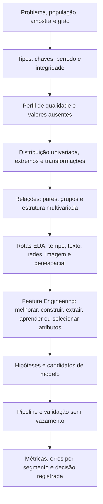

# Mapa de EDA e Seleção de Modelos de Machine Learning

## Propósito

Este mapa organiza técnicas para caracterizar os dados antes de modelar, formular hipóteses e construir uma shortlist de métodos a comparar. O diagnóstico informa quais perguntas fazer; ele não escolhe automaticamente um algoritmo. A decisão depende também do objetivo, do momento de previsão, da população, do custo dos erros e de validação compatível com o uso.

## Percurso principal

## Estratégias por pergunta

| Pergunta de EDA | Técnicas para aplicar | Resultado a registrar | Relação com modelagem |
|---|---|---|---|
| Os dados representam a população de interesse? | Conferir população-alvo, período, quadro amostral, inclusão/exclusão, taxa de resposta e composição por subgrupos; comparar amostra com referências externas quando disponíveis. | Quem está representado, quem está ausente, viés de seleção possível e limites de generalização. | Amostra enviesada não é corrigida por trocar algoritmo. Amostragem/ponderação e validação devem refletir a população de uso. |
| O que uma linha representa? | Dicionário de dados, unidade/grão, chave, unicidade, duplicatas, tipos, intervalos de data, cardinalidade e reconciliação das junções. | Grão, regra de agregação, campos disponíveis no instante de decisão e contagens antes/depois de joins. | Evita duplicação de observações/alvos, vazamento temporal e validação em unidade diferente da aplicação. |
| Como cada variável se distribui? | Tabelas de resumo, stem-and-leaf em amostras pequenas, histograma, ECDF, boxplot/letter values, violin; para categorias, frequência, proporção e categorias raras. | Centro, dispersão, forma, caudas, massas, zeros, assimetria e valores suspeitos. | Sugere baselines, transformações, perdas robustas, codificação e modelos candidatos; não exige normalidade marginal de todos os preditores. |
| Comparações ou relações aparecem entre variáveis? | Dispersão, Pearson/Spearman, gráficos por grupo, tabelas de contingência, heatmap e scatterplot matrix; examine os dados antes de resumir com correlação. | Relação linear/não linear, diferenças entre grupos, interação, associação e possíveis confundidores. | Orienta comparar modelos lineares, termos de interação, árvores/ensembles ou representações multivariadas. Associação não demonstra causalidade. |
| Há sequência, sazonalidade ou dependência? | Linha temporal, regularidade, lacunas, reamostragem, decomposição, suavização, ACF/PACF e diagnósticos de estacionariedade/autocorrelação. | Frequência, tendência, sazonalidade, regime, dependência, horizonte e disponibilidade temporal. | Define baselines temporais e partição cronológica; impede que embaralhamento misture futuro no treino. |
| Os dados têm formato específico? | Texto: comprimento, tokens, termos, n-gramas, sentimento/tópicos. Redes: componentes, grau e estrutura. Geoespacial: cobertura, localização e agregação por região. | Qualidade e estrutura próprias do domínio, concentração e relações que uma tabela plana esconderia. | Pode mudar representação, validação e família candidata; os métodos precisam respeitar dependências textuais, de rede ou espaciais. |
| Outliers são erro ou sinal? | Tukey fences/IQR, z-score ou z-score modificado, resíduos, distância/vizinhança, densidade e métodos multivariados; inspeção por domínio. | Casos a investigar, método, grupo/base de comparação e decisão de manter/corrigir/capar/remover. | Árvores, perdas/escala robustas ou detecção de anomalias podem ser comparados. Um detector marca candidatos; não decide que observações devem ser apagadas. |
| Dá para acelerar o levantamento? | Perfil automatizado e relatórios com estatísticas, nulos, tipos e correlações; revisar alertas e gráficos no contexto do problema. | Relatório reprodutível, avisos revisados e análises adicionais requeridas. | Automação ajuda triagem; não decide grão, causalidade, mecanismo de ausência, vazamento, população ou modelo. |

## Feature Engineering: da evidência à representação

Use o EDA para localizar uma necessidade ou hipótese de representação. Em seguida, compare a transformação dentro de uma validação adequada. A taxonomia útil para organizar o trabalho contém cinco operações, que podem se sobrepor:

- **Melhorar atributos existentes:** corrigir inconsistências e representar escalas, ausência, caudas ou categorias com codificação e transformações apropriadas.
- **Construir atributos:** combinar campos, criar taxas, interações, contagens e resumos baseados no domínio.
- **Selecionar atributos:** manter um subconjunto com utilidade e estabilidade; executar a seleção dentro do fold de treino.
- **Extrair atributos:** converter a representação original em outra, geralmente compacta, como PCA, HOG ou embeddings.
- **Aprender atributos:** deixar um modelo, como uma CNN, aprender representações a partir dos dados.

| Sinal ou tipo de dado observado no EDA | Estratégias de Feature Engineering para comparar | Questão de validação |
|---|---|---|
| Numéricos assimétricos, caudas longas, escalas incompatíveis ou relação curvilínea | Reexpressão log/potência, discretização, escala robusta, interações ou termos polinomiais; manter uma opção sem transformação. | A hipótese melhorou erro e estabilidade? A interpretação na unidade original continua clara? |
| Categóricas com ordem, muitas categorias ou níveis raros | One-hot para categorias sem ordem; ordinal somente com ordem justificável; agrupamento, frequência ou hashing em alta cardinalidade. Target encoding requer cálculo out-of-fold. | Como tratar categoria nova/ausente? A codificação usou apenas treino? |
| Data, eventos repetidos ou dependência temporal | Calendário, recência, lags, janelas móveis/expansivas, EMA e agregações por entidade. | Cada atributo estava disponível no instante de previsão? A divisão preserva tempo e grupos? |
| Texto | Contagens, bolsa de palavras, n-gramas, TF-IDF, hashing ou embeddings conforme tarefa, volume e vocabulário. | A partição separa a unidade independente? Vocabulário e IDF foram ajustados só no treino? |
| Imagem | Pixels/canais, filtros e bordas, HOG/SIFT/LBP ou representação de CNN/transfer learning; aumento apenas no treino. | A divisão separa pessoa, objeto, lote ou cena correlacionada? A resolução/invariância corresponde ao uso? |
| Grafo ou domínio especializado | Atributos de vizinhança/grau, agregados históricos e atributos de processo definidos por conhecimento do domínio. | O grafo ou agregado inclui apenas informação acessível? A validação separa nós/tempo conforme a implantação? |
| Alta dimensionalidade e redundância | Seleção, regularização, PCA, extração manual ou representações aprendidas. | A redução foi ajustada dentro do fold? Compare informação retida, desempenho e interpretação. |
| Ausências e extremos | Imputação, indicadores de ausência e tratamento robusto, investigando mecanismo e validade antes de alterar dados. | O tratamento é ajustado no treino? Extremos são erro, população legítima ou evento importante? |

### Encadeamento prático

1. Registre **achado do EDA → hipótese de atributo → transformação proposta → risco**.
2. Comece com uma representação simples e faça uma alteração por vez para atribuir o ganho.
3. Coloque imputação, escala, codificação, criação aprendida, seleção e redução dentro do pipeline de cada fold.
4. Avalie na mesma partição, com baseline e métrica ligadas ao custo do problema; observe desempenho, estabilidade, equidade, interpretabilidade e custo operacional.
5. Confira consistência entre treino e produção, disponibilidade temporal, categorias novas e mudanças de distribuição.

Atributos não substituem dados representativos, definição correta do alvo ou validação apropriada. Mais transformações também podem aumentar vazamento, sobreajuste, complexidade e fragilidade.

**Conceitos relacionados:** [[redes/machine-learning/conceitos/Feature_Engineering|Feature Engineering]], [[redes/machine-learning/conceitos/Construcao_de_Atributos_Numericos|Construção e Transformação de Atributos Numéricos]], [[redes/machine-learning/conceitos/Engenharia_de_Atributos_Temporais|Engenharia de Atributos Temporais]], [[redes/machine-learning/conceitos/Representacao_de_Texto_para_ML|Representação de Texto para ML]], [[redes/machine-learning/conceitos/Extracao_de_Atributos_de_Imagens|Extração de Atributos de Imagens]], [[redes/machine-learning/conceitos/Pipelines_de_Feature_Engineering|Pipelines de Feature Engineering sem Vazamento]], [[redes/machine-learning/conceitos/Seleção_de_Atributos__Feature_Selection_|Seleção de Atributos]], [[redes/machine-learning/conceitos/One-Hot_Encoding|One-Hot Encoding]] e [[redes/machine-learning/conceitos/Redução_de_Dimensionalidade|Redução de Dimensionalidade]].

## Distribuição e shortlist de modelos

| Evidência observada | Candidatos/tratamentos que vale comparar | Ressalva |
|---|---|---|
| Alvo contínuo, relação aproximadamente linear | Baseline média/mediana, regressão linear e regularizada; comparar árvores/boosting se houver limiares ou interações. | Examine resíduos e pressupostos ligados ao objetivo. Preditores não precisam ser normalmente distribuídos para toda regressão linear. |
| Cauda longa, assimetria ou extremos válidos | Reexpressão justificável, escalas/perdas robustas, regressão quantílica e árvores/boosting. | Compare também a interpretação na escala original; não apague caudas apenas para simetrizar o gráfico. |
| Alvo de contagem ou muitos zeros | Baseline de contagem, modelos Poisson/binomial negativa ou em duas etapas quando apropriados; comparar com árvores. | Investigue exposição, sobredispersão e o significado dos zeros; a distribuição marginal não revela sozinha o processo gerador. |
| Classes raras | Baseline majoritária, logística/árvores/ensembles ou SVM com pesos; PR-AUC, precisão/recall, calibração e limiar segundo custo. | Amostragem, pesos e limiar são ajustados sem usar o teste final; reamostragem fica dentro do treino de cada fold. |
| Escalas incompatíveis e distância como critério | Escala em pipeline para KNN, SVM, PCA, K-Means ou GMM; comparar com árvores que normalmente não dependem da escala numérica da mesma forma. | A distância depende da escala e da representação; padronizar não torna variáveis irrelevantes ou ruins em úteis. |
| Sem alvo e objetivo de segmentar | K-Means para hipótese de grupos compactos, GMM, hierárquico ou densidade conforme forma/ruído. | Projeções 2D e métricas internas não provam grupos reais nem valor operacional. |
| Dados temporais ou entidades repetidas | Baseline temporal, regressão com atributos de calendário/lags, métodos de série ou modelos sequenciais conforme o horizonte. | Validar por tempo ou grupo de acordo com a implantação; não misturar janelas dependentes sem justificativa. |
| Texto esparso e alta dimensão | Representação textual + Naive Bayes, regressão logística ou SVM linear como referências iniciais. | Tokenização, divisão por documento/autor/tempo e duplicatas podem dominar o resultado. |

## Sequência de trabalho recomendada

1. Escreva pergunta, alvo, população, grão, horizonte e custo do erro.
2. Preserve a origem bruta; perfil tipos, chaves, duplicatas, cardinalidade, datas, ausências e validade.
3. Explore uma variável por vez; compare forma e resumo resistente antes de transformar ou excluir casos.
4. Examine relações com alvo, grupos e tempo, usando gráficos adequados aos tipos e denominadores corretos.
5. Aplique a rota de domínio necessária para séries, texto, redes ou dados geoespaciais.
6. Registre cada achado no formato: **observação → hipótese → teste/candidato → risco/limite**.
7. Faça uma shortlist pequena com baseline e alternativas; coloque imputação, escala, codificação, seleção e reamostragem dentro da validação.
8. Compare a mesma métrica, partição e orçamento; analise erros por segmento e preserve um teste final não usado na escolha.

## Conceitos desta rede

As relações conceituais entre as notas vivem em `conceitos/`; as notas do mapa e das fontes servem para planejar/leitura e são excluídas da visualização conceitual pelo filtro do Graph View.

- [[redes/machine-learning/conceitos/Amostragem_e_Representatividade|Amostragem e Representatividade]]
- [[redes/machine-learning/conceitos/Estatisticas_Resistentes_e_Formas_de_Distribuicao|Estatísticas Resistentes e Formas de Distribuição]]
- [[redes/machine-learning/conceitos/Reexpressao_de_Variaveis|Reexpressão de Variáveis]]
- [[redes/machine-learning/conceitos/Visualizacao_Exploratoria_e_Codificacao_Visual|Visualização Exploratória e Codificação Visual]]
- [[redes/machine-learning/conceitos/Analise_Bivariada_e_Tabelas_de_Contingencia|Análise Bivariada e Tabelas de Contingência]]
- [[redes/machine-learning/conceitos/Analise_Multivariada_Exploratoria|Análise Multivariada Exploratória]]
- [[redes/machine-learning/conceitos/Suavizacao_e_Comparacao_de_Sequencias|Suavização e Comparação de Sequências]]
- [[redes/machine-learning/conceitos/Diagnostico_Exploratorio_de_Series_Temporais|Diagnóstico Exploratório de Séries Temporais]]
- [[redes/machine-learning/conceitos/Analise_Exploratoria_de_Texto|Análise Exploratória de Texto]]
- [[redes/machine-learning/conceitos/Analise_Exploratoria_de_Redes|Análise Exploratória de Redes e Árvores]]
- [[redes/machine-learning/conceitos/Analise_Exploratoria_Geoespacial|Análise Exploratória Geoespacial]]
- [[redes/machine-learning/conceitos/Metodos_de_Deteccao_de_Outliers|Métodos de Detecção de Outliers]]
- [[redes/machine-learning/conceitos/Perfilamento_e_EDA_Automatizada|Perfilamento e EDA Automatizada]]
- [[redes/machine-learning/conceitos/Feature_Engineering|Feature Engineering]]
- [[redes/machine-learning/conceitos/Construcao_de_Atributos_Numericos|Construção e Transformação de Atributos Numéricos]]
- [[redes/machine-learning/conceitos/Engenharia_de_Atributos_Temporais|Engenharia de Atributos Temporais]]
- [[redes/machine-learning/conceitos/Representacao_de_Texto_para_ML|Representação de Texto para ML]]
- [[redes/machine-learning/conceitos/Extracao_de_Atributos_de_Imagens|Extração de Atributos de Imagens]]
- [[redes/machine-learning/conceitos/Pipelines_de_Feature_Engineering|Pipelines de Feature Engineering sem Vazamento]]

## Fontes

Os registros bibliográficos e localizadores por capítulo estão em `redes/machine-learning/fontes/EDA_Aulas_Livro_e_Laboratorio.md` e `redes/machine-learning/fontes/Feature_Engineering_Livros_e_Laboratorio.md`. O conteúdo dos TXT não preserva páginas de forma uniforme; os capítulos/seções são pistas para conferir nos originais, e não citações de página.
